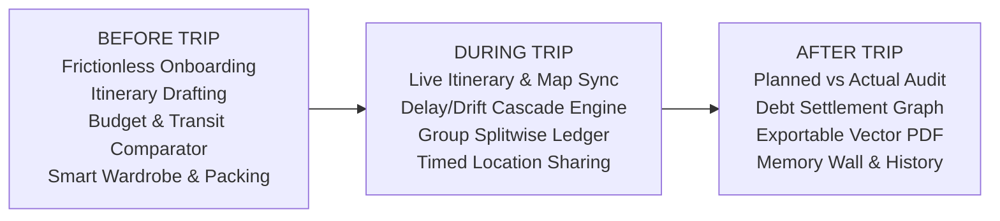
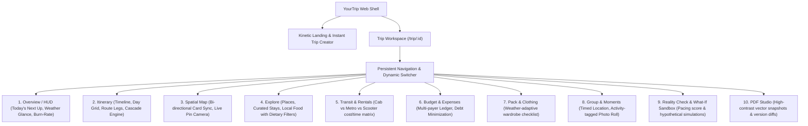
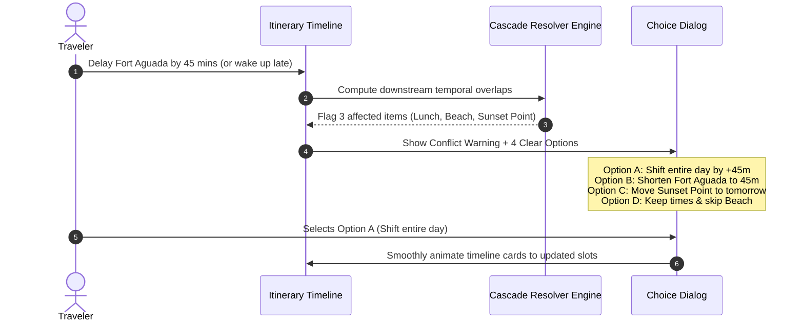
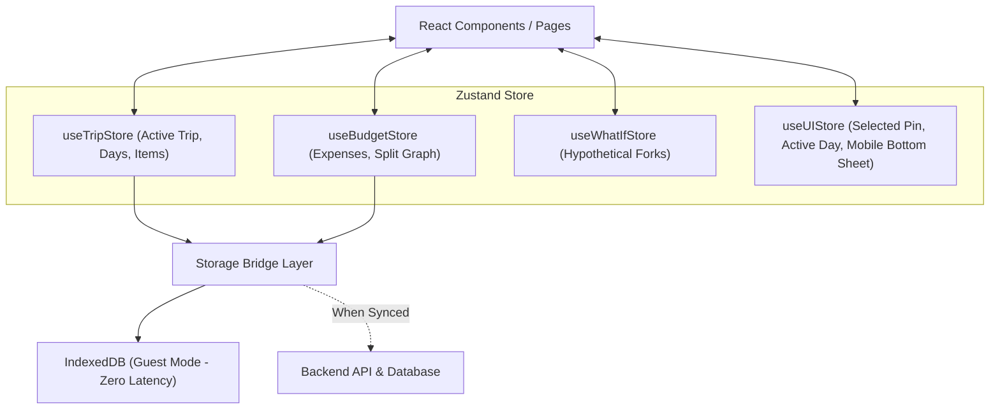

# YourTrip: Personal Trip Operating System (TripOS)
## Comprehensive Architectural Blueprint & Engineering Specification

> **Core Philosophy:** *"AI should assist the traveler, not make the decisions for the traveler. The user always remains in control."*

---

### 1. Executive Product Understanding

Current travel tools force travelers into painful app-switching: Google Maps for navigation, Splitwise for bills, Notes/Notion for schedules, WhatsApp for group chats, Booking/Airbnb for stays, Weather apps for forecasts, and Google Photos for albums. When unexpected delays occur, static itineraries break immediately, leading to travel stress.

**YourTrip (TripOS)** is not an AI chatbot that hallucinates rigid plans, nor a static brochure generator. It is an **active digital companion before, during, and after a trip**:



---

### 2. Proposed Information Architecture

The information architecture follows a **Contextual Dual-Layer** structure designed for high-density desktop dashboards and single-thumb mobile ergonomics:



---

### 3. Proposed Page & Screen Structure

| Route / Screen | Primary Purpose | Responsive Desktop Layout | Responsive Mobile Layout |
| :--- | :--- | :--- | :--- |
| `/` | Landing & Frictionless Creator | Kinetic Hero, Interactive Route SVG, Floating 4-Input Creator Bar | Stacked Hero, One-Thumb Destination Bar, Quick Budget Dial |
| `/trip/[id]` | Main Workspace Hub | 2-Column: Left Timeline, Right Interactive Map + Context Drawer | Top Day Selector + Feed View, Bottom Navigation Bar |
| `/trip/[id]/itinerary` | Core Schedule Engine | Full interactive timeline with travel segments, timing badges, and cascade controls | Vertical scroll timeline with quick swipe action buttons (`Done`, `Delay`, `Skip`) |
| `/trip/[id]/explore` | Discovery & Details | Multi-column grid with transparent "Why Recommended" cards | Categorized horizontal carousel chips + bottom detail sheet |
| `/trip/[id]/budget` | Splitwise & Expenses | Budget progress gauge + expense feed + debt settlement matrix | Summary card + quick floating `+ Expense` trigger |
| `/trip/[id]/packing` | Packing & Wardrobe | 2-Column: Clothing recommendations vs. Checkable Packing List | Tabbed view with category progress rings |
| `/trip/[id]/what-if` | Hypothetical Sandbox | Side-by-side diff: "Current Plan" vs "Simulated Scenario" | Slider-based scenario toggles with consequence preview |
| `/trip/[id]/export` | PDF Export & History | Live vector document preview with print & download triggers | Full-screen print preview with WhatsApp sharing link |

---

### 4. Core User Flows

#### Flow A: Frictionless Onboarding (0 to Workspace in <10 seconds)
1. User lands on `/` (no modal, no login wall).
2. Fills 4 fields: Destination (`Goa`), Dates (`15–19 Nov`), Travelers (`4`), Budget/Person (`₹15,000`).
3. Clicks **"Create Trip"** $\rightarrow$ Animated route line traces across the screen while the workspace instantiates in `IndexedDB`.
4. Workspace loads with a sensible baseline itinerary, categorized budget, and weather snapshot.
5. Soft prompt appears: *"Want to personalize this with dietary or travel preferences?"* (dismissible, never blocking).

#### Flow B: Real-Life Schedule Cascade (The Signature UX)


#### Flow C: Multi-Payer Expense Splitting
1. Member logs an expense: *Dinner ₹3,200 paid by Priya for 4 people*.
2. System calculates individual shares ($\text{₹800 each}$).
3. Debt Simplification algorithm recalculates the optimal settlement graph (reducing $N^2$ payments down to minimum direct peer transfers).
4. Real-time visual feedback updates the overall budget burn bar.

---

### 5. Technical Architecture

```
┌─────────────────────────────────────────────────────────────────┐
│                      PRESENTATION LAYER                         │
│  Next.js 14 App Router • TailwindCSS • Framer Motion • Lucide  │
│  Canvas Route Animators • MapLibre / Leaflet GIS Viewports      │
└───────────────────────────────┬─────────────────────────────────┘
                                │
┌───────────────────────────────▼─────────────────────────────────┐
│                     BUSINESS DOMAIN LAYER                       │
│  ├─ ItineraryEngine (Conflict detection, leg travel duration)   │
│  ├─ CascadeEngine (Downstream time-shift propagation)           │
│  ├─ SplitwiseEngine (Greedy graph debt settlement algorithm)    │
│  ├─ FeasibilityEngine (Pacing index, fatigue & weather risks)   │
│  ├─ WhatIfSandbox (Immutable state branching & diff preview)    │
│  └─ ProvenanceTracker (Labels data: LIVE / ESTIMATED / AI / ...)│
└───────────────────────────────┬─────────────────────────────────┘
                                │
┌───────────────────────────────▼─────────────────────────────────┐
│                   STATE & PERSISTENCE LAYER                     │
│  ├─ Zustand Local-First Store (IndexedDB via idb-keyval)        │
│  ├─ Offline-First Sync Adapter (Optimistic mutation queue)      │
│  └─ Cloud Sync Provider (Supabase / Postgres via Prisma)       │
└───────────────────────────────┬─────────────────────────────────┘
                                │
┌───────────────────────────────▼─────────────────────────────────┐
│                  EXTERNAL INTEGRATION BOUNDARIES                │
│  ├─ Weather Adapter (Open-Meteo real-time & historical)         │
│  ├─ GIS & Routing Adapter (OSRM / CartoDB / MapLibre)          │
│  ├─ PDF Render Service (@react-pdf / html2pdf vector engine)    │
│  └─ AI Intelligence Gateway (Structured JSON-schema LLM calls)  │
└─────────────────────────────────────────────────────────────────┘
```

---

### 6. Recommended Tech Stack

- **Framework**: **Next.js 14+ (App Router, React, TypeScript)**. Provides edge caching, SSR for landing pages, client-side hydration for local-first guest mode, and API route handlers for secure server-side operations.
- **Styling & Design System**: **TailwindCSS** with a custom warm cinematic palette (`terracotta`, `slate`, `amber`, `sand`, `emerald`), avoiding generic AI neon gradients.
- **Motion & Kinetic UI**: **Framer Motion** for spring physics, layout animations (`layoutId`), card re-arrangements, and responsive gesture-driven drawers.
- **Spatial Mapping**: **MapLibre GL / Leaflet** with vector tiles (CartoDB Positron / OSM Voyager) for lightning-fast zero-API-key mapping, with transparent adapters for Google Maps.
- **State Management**: **Zustand** with multi-slice pattern + `persist` middleware storing in **IndexedDB** for seamless offline capability.
- **PDF Generation**: **Client-side Vector PDF engine** using `@react-pdf/renderer` or `jspdf` + `html2canvas` for crisp, printable tabular schedules with zero server compute costs.
- **Icons & Data Viz**: **Lucide React** & **Recharts** (clean SVG budget breakdowns).

---

### 7. Core Data Model

```typescript
// Provenance tagging contract
export type DataProvenance = 'LIVE' | 'ESTIMATED' | 'AI_RECOMMENDED' | 'USER_ENTERED' | 'UNAVAILABLE';

export interface ProvenanceValue<T> {
  value: T;
  provenance: DataProvenance;
  lastUpdated?: string;
  note?: string;
}

export type ActivityStatus = 'PLANNED' | 'IN_PROGRESS' | 'DONE' | 'DELAYED' | 'SKIPPED' | 'REPLACED';

export interface ItineraryItem {
  id: string;
  dayId: string;
  order: number;
  title: string;
  category: 'ATTRACTION' | 'FOOD' | 'BEACH' | 'NATURE' | 'RELAX' | 'TRAVEL';
  location: {
    name: string;
    address: string;
    lat: number;
    lng: number;
    openingHours?: string;
  };
  timeSlot: {
    plannedStart: string; // "10:30"
    plannedEnd: string;   // "12:00"
    actualStart?: string; // "11:15"
    actualEnd?: string;
  };
  durationMinutes: number;
  recommendedDurationMinutes: number;
  travelFromPrevious?: {
    distanceKm: number;
    durationMinutes: number;
    recommendedMode: 'CAB' | 'WALK' | 'SCOOTER' | 'BUS';
    estimatedCost: ProvenanceValue<number>;
    trafficCondition: ProvenanceValue<'LIGHT' | 'MODERATE' | 'HEAVY'>;
  };
  weatherForecast?: ProvenanceValue<{
    condition: string;
    temperatureC: number;
    precipitationProbability: number;
  }>;
  expectedCrowd?: ProvenanceValue<'LOW' | 'MEDIUM' | 'HIGH'>;
  estimatedCost: ProvenanceValue<number>;
  whyRecommended?: string; // Explainability
  notes?: string;
  status: ActivityStatus;
}

export interface DayPlan {
  id: string;
  tripId: string;
  dayNumber: number;
  date: string; // ISO date "2026-11-15"
  themeTitle: string;
  items: ItineraryItem[];
}

export interface Expense {
  id: string;
  tripId: string;
  title: string;
  amount: number;
  category: 'STAY' | 'FOOD' | 'TRANSPORT' | 'ACTIVITIES' | 'SHOPPING' | 'OTHER';
  paidByMemberId: string;
  splitAmongMemberIds: string[];
  splitType: 'EQUAL' | 'EXACT' | 'PERCENTAGE';
  createdAt: string;
  activityId?: string;
}

export interface Trip {
  id: string;
  title: string;
  destination: string;
  startDate: string;
  endDate: string;
  travelerCount: number;
  budgetPerPerson: number;
  totalPlannedBudget: number;
  isGuest: boolean;
  shareId: string;
  members: TripMember[];
  days: DayPlan[];
  expenses: Expense[];
  packingList: PackingItem[];
  exportHistory: ExportSnapshot[];
}
```

---

### 8. State Management Architecture



---

### 9. Animation Architecture & Kinetic Design System

1. **Travel Geometry Tracing**: SVG dashoffset path animations connecting itinerary stops across days to visually convey continuous motion.
2. **Timeline Cascade Shifting**: Card reordering via Framer Motion `layout` properties. When a user shifts an activity, downstream cards visibly glide downward with spring physics (`stiffness: 300, damping: 28`).
3. **Number Tickers**: Custom odometer-style numeric transition for budget counters ($₹60,000 \rightarrow ₹58,000$).
4. **Bi-directional Spatial Focus**: Tapping an itinerary card smoothly triggers map flyTo animation to center the landmark; tapping a map marker highlights the timeline card.
5. **Accessibility Commitment**: Complete support for `prefers-reduced-motion`—all displacement animations transition to instant state changes or subtle opacity fades.

---

### 10. API Integration Strategy & Strict Data Provenance

To guarantee complete honesty and avoid fabricated data:
- **Every data field** rendered in the UI displays an explicit provenance badge on hover/tap:
  - 🟢 **LIVE**: Directly queried from real-time endpoints (e.g. current Open-Meteo weather).
  - 🟡 **ESTIMATED**: Derived via algorithms (e.g., standard fuel consumption for 25km scooter ride).
  - 🔵 **AI RECOMMENDED**: Synthesized advice with an explicit *"Why?"* reasoning tooltip.
  - 🟣 **USER ENTERED**: Input directly by the traveler.
  - ⚪ **UNAVAILABLE**: Gracefully shown as "Live data not connected" rather than inventing numbers.

---

### 11. Guest Mode Strategy

- **Zero-Barrier Access**: A first-time user can create, edit, plan, split expenses, and export PDFs without ever providing an email, password, or credit card.
- **Persistence**: Trips are stored in the browser's `IndexedDB` with automated recovery if the tab is closed.
- **Exportable State**: Guest users can export/import their raw trip file or generate a shareable URL containing an LZ-compressed trip payload.
- **Non-blocking Upgrade**: An unobtrusive top banner (*"Trip saved locally. Claim this trip to enable multi-device sync"*) allows instant email OTP linking when desired.

---

### 12. Authentication Strategy

- **Philosophy**: *"Signup is a benefit, not a barrier."*
- **Mechanism**: Passwordless Magic Link / Email OTP and Google OAuth.
- **Seamless Merge**: When a guest user logs in, the client immediately migrates the local `IndexedDB` trip record to the user's cloud account without data loss.

---

### 13. PDF Generation Strategy & Snapshot Tracking

1. **Clean, Printable Document Structure**:
   - Header: Trip Name, Dates, Traveler Count, Budget Summary.
   - Day-by-Day Tabular Breakdown: Time | Activity | Location | Travel Leg | Mode | Cost | Notes.
   - Important Emergency Contacts & Packing Checklist Summary.
2. **Snapshot Tracking**: Every generated PDF stores a content revision hash (`revisionId: rev_001_173000`).
3. **Drift Warning**: If an itinerary is altered post-export, the UI shows:
   > ⚠️ *Itinerary has changed since your last export (v1 - Nov 12). [Export Updated PDF]*

---

### 14. Responsive & Mobile Strategy

- **Desktop View**: Split workspace with an interactive master timeline on the left and a sticky spatial map + context drawer on the right.
- **Mobile View**: Single-column app-like experience featuring:
  - Day carousel pills at the top.
  - Quick-action floating HUD (*"Running 15m Late"*, *"Mark Done"*, *"Quick Expense"*).
  - Bottom navigation dock with 5 core tabs (*Today, Plan, Map, Split, More*).
  - Slide-up bottom sheets for place exploration and cascade conflict resolution.

---

### 15. Security & Privacy Approach

- **Location Sharing**: Purely opt-in with strict time bounds (e.g., *Share for 30 minutes*, *Share for 2 hours*, or *Revoke now*). No continuous passive background tracking.
- **Share Links**: Three distinct permission levels:
  - `VIEW_ONLY`: Read-only link for friends and family back home.
  - `CAN_EDIT`: Collaborative link with group member attribution.
  - `OWNER`: Full administrative controls.
- **Zero API Key Leakage**: All weather, routing, and AI calls route through backend serverless handlers.

---

### 16. Phased Implementation Roadmap

```mermaid
gantt
    title Development Phases
    dateFormat  X
    axisFormat  Day %d
    section Phase 1
    Core Architecture & Kinetic Workspace :active, 0, 3
    section Phase 2
    Place Intelligence & Budget Comparator :3, 6
    section Phase 3
    Cascade Delay Engine & What-If Sandbox :6, 9
    section Phase 4
    Group Splitwise & Timed Location Sharing :9, 12
    section Phase 5
    Clean Tabular PDF Engine & Revision History :12, 14
    section Phase 6
    Live Data Adapters & AI Explanations :14, 16
    section Phase 7
    Kinetic Polish & Mobile PWA Hardening :16, 18
```



---

### 17. What Must Be Built First (Phase 1 Deliverables)

1. Next.js 14 App structure with Tailwind custom design tokens and Framer Motion integration.
2. Kinetic Landing Page with the 4-input frictionless trip creator.
3. Local-first Zustand `TripStore` backed by IndexedDB.
4. Core Trip Workspace (`/trip/[id]`) with responsive dual-pane layout.
5. Interactive Itinerary Timeline with Day switcher, activity cards, and time slot calculations.
6. The Cascade Conflict Drawer (demonstrating how a +45m delay presents Options A/B/C/D).
7. Working Tabular Vector PDF Exporter.

---

### 18. Technical Risks & Mitigation

| Identified Risk | Impact | Concrete Mitigation |
| :--- | :--- | :--- |
| **Map re-rendering overhead on low-end phones** | Sluggish FPS during scrolling | Use lightweight raster/vector hybrid tiles (Leaflet/MapLibre) and detach map rendering from the scroll container; only pan when cards cross threshold. |
| **Cascade engine infinite time recursion** | Frozen UI during complex schedule shifts | Implement forward-only directed acyclic graph (DAG) recalculation with a maximum lookahead constraint of the current day. |
| **LocalStorage 5MB quota exhaustion** | Data loss for photo-heavy trips | Store photos as compressed WebP thumbnails in IndexedDB, offloading heavy media to local blob storage. |
| **PDF layout pagination breakage** | Ugly sliced tables in exported PDFs | Enforce strict CSS `@media print` break-inside-avoid rules and use deterministic table rows with fixed row heights. |

---

### 19. What Should NOT Be Built Yet

- ❌ **Real Payment Processing (Stripe/Razorpay)**: Not required. Focus purely on the "Record, Split, Settle" ledger.
- ❌ **Mandatory Social Authentication**: Do not block any user behind OAuth.
- ❌ **Passive Continuous GPS Background Tracking**: Unnecessary, battery-draining, and intrusive.
- ❌ **Giant Free-form AI Chatbot**: Keeps the interface focused, structured, visual, and user-controlled.
